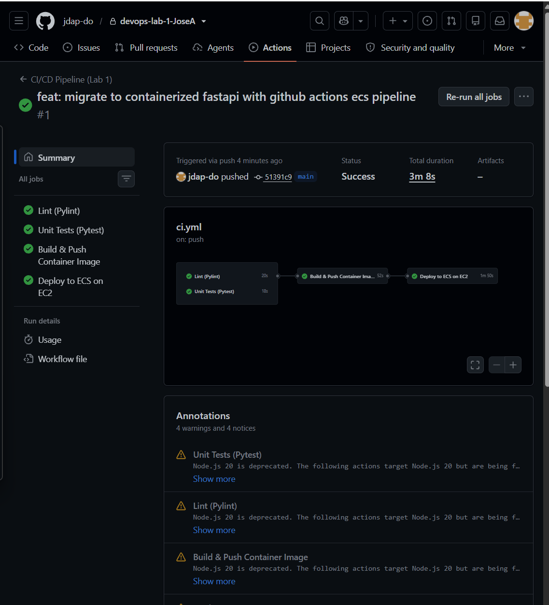
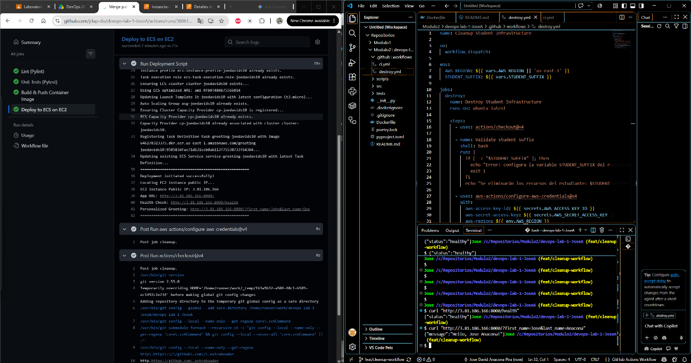
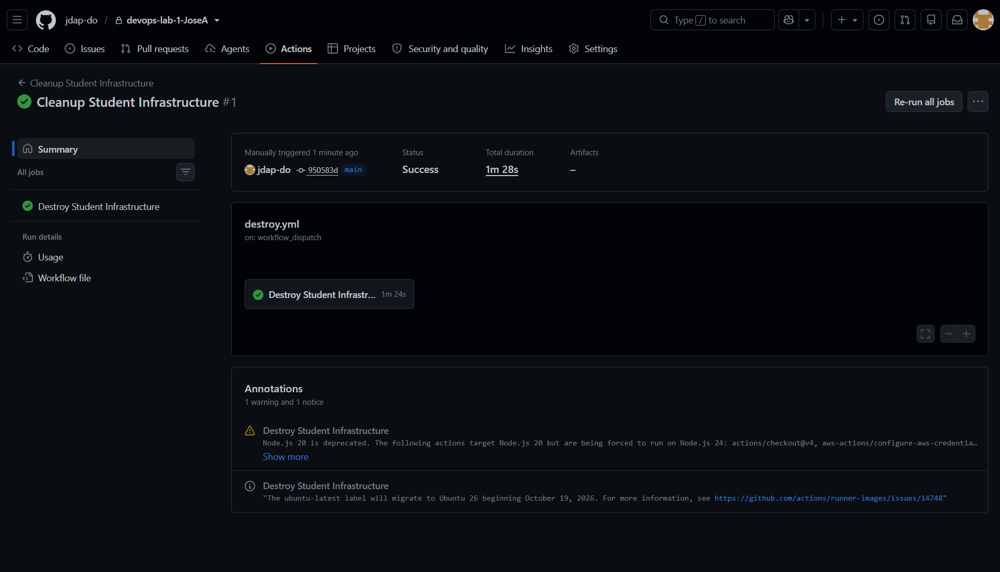

# Laboratorio 1 CI/CD con GitHub Actions y Amazon ECS

**Estudiante:** Jose David Anacona Pira  
**Usuario AWS:** joedavids10  
**Región:** us-east-1  
**Repositorio:** https://github.com/jdap-do/devops-lab-1-JoseA

## 1. Arquitectura de contenedores

Se utilizó una aplicación en Python con FastAPI. La aplicación cuenta con dos rutas: `/`, que devuelve un saludo usando los parámetros `first_name`, `last_name` y `/health`, que permite consultar su estado.

Se usó Docker para incluir el código y las dependencias en una imagen. El contenedor utiliza Python 3.12 y ejecuta la aplicación con Uvicorn en el puerto 8000.

La imagen se publicó en Amazon ECR. Luego se utilizó Amazon ECS para ejecutarla en una instancia EC2 administrada por un Auto Scaling Group. La aplicación se consultó mediante la IP pública de la instancia y el puerto 8000.

## 2. Conceptos de CI/CD aplicados

Se automatizaron las validaciones y el despliegue de la aplicación por medio de GitHub Actions.

Para la integración continua se utilizaron Pylint y Pytest.
Pylint revisa el código y Pytest ejecuta las pruebas.
Estas comprobaciones se activan automaticamente al crear un Pull Request hacia `main`.

Al fusionar los cambios en `main`, se ejecuta el pipeline completo. Se construye la imagen Docker, se publica en ECR y se ejecuta el script de despliegue en ECS.

Las credenciales de AWS se configuraron como secretos en las configuraciones del repositorio. También se configuraron las variables `AWS_REGION` y `STUDENT_SUFFIX`.

## 3. Evidencia del pipeline automático

Se ejecutó el pipeline y finalizaron correctamente sus cuatro etapas: revisión del código, pruebas, construcción y publicación de la imagen, y ejecución del despliegue.



## 4. Evidencia de la petición HTTP

Se realizaron dos consultas desde la terminal de VS Code:

```bash
curl "http://3.81.186.166:8000/health"
curl "http://3.81.186.166:8000/?first_name=Jose&last_name=Anacona" 
```

Se obtuvieron las siguientes respuestas:

```json
{"status":"healthy"}
{"message":"Hello, Jose Anacona!"}
```

Con estas pruebas se comprobó que la aplicación respondía y que el saludo incluía el nombre y el apellido enviados.



La IP se utilizó durante el laboratorio. Después de la limpieza no se espera que la aplicación siga disponible en esa dirección.

## 5. Evidencia del pipeline manual de limpieza

Se creó el archivo `.github/workflows/destroy.yml` para ejecutar la limpieza de forma manual desde GitHub Actions.

El workflow utiliza el script `scripts/destroy.sh` y el sufijo `joedavids10` para identificar los recursos del laboratorio.

Se realizó la ejecución y terminó con estado Success, como se observa en la captura. Para confirmar que todos los recursos fueron eliminados, se requiere una revisión adicional en AWS.



## 6. Propuestas de mejora

1. Agregar una comprobación de `/health` al final del despliegue, para verificar que la aplicación responda antes de darlo por terminado. Esto por que aunque el pipeline resulto exitoso, en AWS las tareas estaban en pendientes y no se levantaron hasta que hubo disponibilidad de los recursos.

2. Revisar todos los archivos que puedan ser dependencias del pipeline, ya que si falta alguno de ellos el pipeline falla, tal como paso con el README que no se encontraba inicialmente pero si estaba mencionado en el pyproject.toml.

3. Agregar una revisión al final de la limpieza para informar si algún recurso no pudo eliminarse, esto basado en que varias ejecuciones del destructor se demoraron y los recursos se demoraron en liberarse.